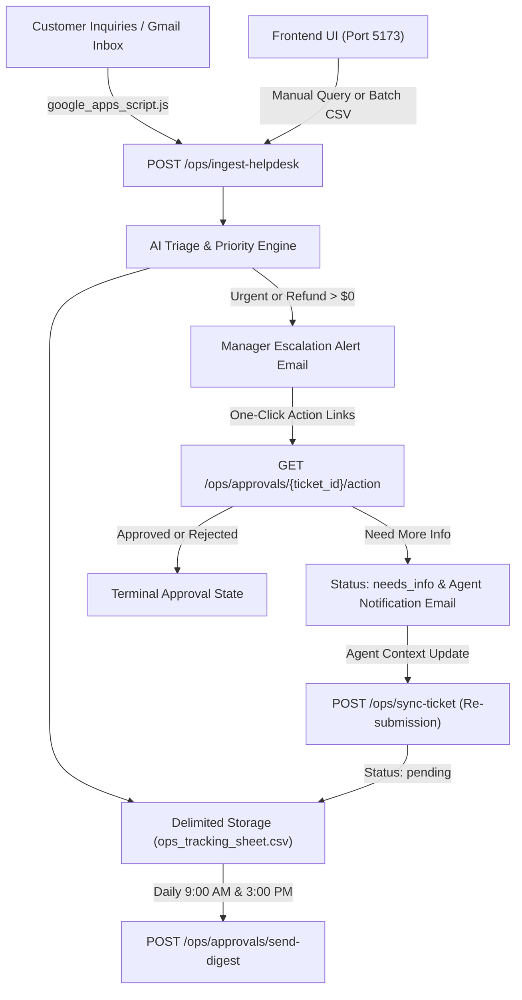

# ticket-api

A support ticket analytics service, AI-powered triage platform, and billing operations sync system.

Requires Python 3.8+ (tested on Python 3.11) and Node.js 18+.

---

## 1. System Overview & Architecture

`ticket-api` automates customer support workflows, AI triage classification, billing operations sync, and manager escalation lifecycles:

- **AI Triage & Classification**: Classifies customer queries into domain categories (`Billing`, `Refunds`, `Technical`, `Login`, `Shipping`, `Account`), estimates priority levels (`urgent`, `high`, `normal`, `low`), and retrieves relevant knowledge base articles.
- **Real-Time Email Ingestion Webhook**: Ingests support inquiries via `POST /ops/ingest-helpdesk`, extracts refund amounts and priority, eliminates duplicate threads, and filters out marketing or newsletter senders.
- **Live Helpdesk Tracking Sheet**: Persists ticket operational data in a delimited tabular storage (`data/ops_tracking_sheet.csv`) with newline sanitization, currency normalization, and Excel file lock contention handling.
- **One-Click Approval & Escalation Lifecycle**: Immediately sends escalation notifications for urgent billing or refund requests. Managers can review requests with one click (`Approved`, `Rejected`, `Need More Info`).
- **Support Agent Re-Submission Loop**: When a manager requests more information, the assigned agent receives an automated notification, updates the ticket, and re-submits it back into the pending review queue.
- **Scheduled Batch Digest**: Consolidates pending manager approvals into a scheduled daily digest email.
- **Interactive Web Interface**: Single-page application built with React, TypeScript, and Vite for manual query ingestion, batch CSV uploads, ticket re-submission, and live tracking sheet management.



---

## 2. Quick Start: Clean-Machine Setup

Follow these exact steps to run and test the project from scratch on a clean machine.

### Prerequisites

- **Python**: 3.8 or higher (Python 3.11 recommended; verify with `python --version`)
- **Node.js**: 18 or higher (verify with `node --version`)
- **Git**: Installed and configured (verify with `git --version`)

### Step 1: Clone Repository & Navigate to Execution Root

All git commands, build scripts, test suites, and application servers execute inside `ticket-api/`:

```bash
git clone https://github.com/imSai-py/bitcot-technical-assignment.git
cd bitcot-technical-assignment/ticket-api
```

### Step 2: Set Up Python Virtual Environment

Create and activate an isolated virtual environment:

- **Windows (PowerShell)**:
  ```powershell
  python -m venv .venv
  .venv\Scripts\Activate.ps1
  ```

- **Linux / macOS (Bash)**:
  ```bash
  python3 -m venv .venv
  source .venv/bin/activate
  ```

### Step 3: Install Backend Dependencies

Install the locked Python dependencies:

```bash
pip install -r requirements.txt
```

### Step 4: Configure Environment Variables

Copy the example environment template. All default settings work out of the box with offline mock fallbacks:

- **Windows**:
  ```powershell
  Copy-Item .env.example .env
  ```

- **Linux / macOS**:
  ```bash
  cp .env.example .env
  ```

#### Environment Variables Reference

| Variable | Default / Mock Value | Description |
| :--- | :--- | :--- |
| `PORT` | `8000` | Backend server port |
| `HOST` | `0.0.0.0` | Backend host listener |
| `TICKETS_DATA_PATH` | `data/tickets_sample.csv` | Initial ticket dataset path |
| `OPS_TRACKING_PATH` | `data/ops_tracking_sheet.csv` | Helpdesk operations tracking spreadsheet |
| `BASE_URL` | `http://localhost:8000` | Base URL used to generate one-click approval links |
| `CORS_ORIGINS` | `http://localhost:5173,http://127.0.0.1:5173` | Allowed CORS origins for frontend web UI |
| `ESCALATION_EMAIL` | `manager@example.com` | Manager email recipient for urgent alerts |
| `ESCALATION_MANAGER_EMAIL` | `manager@example.com` | Primary manager email recipient |
| `AGENT_NOTIFICATIONS_EMAIL` | `agent@example.com` | Support agent recipient for info requests |
| `GEMINI_API_KEY` | `mock_gemini_api_key_placeholder` | Google Gemini API key (offline fallback used if omitted) |
| `GEMINI_MODEL` | `gemini-3.1-flash-lite` | Model identifier for Gemini inference |
| `GEMINI_TIMEOUT_MS` | `10000` | Timeout threshold in milliseconds for model API calls |
| `SMTP_SERVER` | `smtp.example.com` | SMTP server host (mock logger used if unconfigured) |
| `SMTP_PORT` | `587` | SMTP server port |
| `SMTP_USER` | `mock_notifications@example.com` | SMTP authentication user |
| `SMTP_PASSWORD` | `mock_smtp_password_placeholder` | SMTP authentication password |
| `SMTP_FROM` | `Billing Ops <notifications@example.com>` | Sender address for outgoing emails |

### Step 5: Start Backend Application Server

Launch the FastAPI development server on port 8000:

- **Using PowerShell script (automatically terminates stale listeners on port 8000)**:
  ```powershell
  powershell -ExecutionPolicy Bypass -File scripts/start-server.ps1
  ```

- **Or using standard Uvicorn**:
  ```bash
  uvicorn app.main:app --reload --port 8000
  ```

Verify in your browser or terminal:
- **System Health Check**: [http://localhost:8000/health](http://localhost:8000/health)
- **Interactive Swagger Docs**: [http://localhost:8000/docs](http://localhost:8000/docs)
- **Web Analytics Overview**: [http://localhost:8000/](http://localhost:8000/)

### Step 6: Set Up and Run Frontend UI

Open a second terminal window inside `ticket-api/`:

```bash
cd frontend
npm install
npm run dev
```

The frontend launches at [http://localhost:5173/](http://localhost:5173/). It connects automatically to the local backend at `http://localhost:8000` for live triage, batch ingestion, ticket re-submission, and spreadsheet management.

---

## 3. Automated Verification Gate

Before committing code or deploying, run the unified verification script. It executes all Python backend tests, code linters, formatters, and TypeScript frontend tests.

- **Windows (PowerShell)**:
  ```powershell
  powershell -ExecutionPolicy Bypass -File scripts/verify-all.ps1
  ```

- **Linux / macOS (Bash)**:
  ```bash
  bash scripts/verify-all.sh
  ```

### Targeted Test Commands

| Test Suite | Scope | Command | Expected Output |
| :--- | :--- | :--- | :--- |
| **Backend Tests** | 165 Python unit & integration tests | `pytest` | `165 passed` |
| **Python Linter** | Ruff linting rules | `ruff check .` | `All checks passed!` |
| **Python Formatter** | Black style conformity | `black --check .` | `All done!` |
| **Frontend Tests** | 11 Vitest UI component tests | `cd frontend && npm test` | `11 passed` |
| **Type Check & Build** | TypeScript compiler & Vite build | `cd frontend && npm run build` | `built in ...` |

---

## 4. End-to-End Manual Testing Scenarios

Follow these scenarios to test every feature from a terminal or web browser.

### Scenario 1: Diagnostic Health Probe

Verify system availability, storage accessibility, dataset loading, and scheduler status:

```bash
curl http://localhost:8000/health
```

**Expected Response (HTTP 200 OK)**:
```json
{
  "status": "healthy",
  "version": "1.0.0",
  "storage": "accessible",
  "tickets_data": "loaded",
  "knowledge_base": "indexed",
  "digest_scheduler": "ready"
}
```

### Scenario 2: Helpdesk Email Ingestion & Manager Escalation

Simulate receiving a high-priority customer refund request:

```bash
curl -X POST http://localhost:8000/ops/ingest-helpdesk \
  -H "Content-Type: application/json" \
  -d '{
    "subject": "Urgent refund request for order #8841",
    "problem": "I was double charged $250.00 for my subscription. Please refund immediately.",
    "customer_email": "customer@example.com",
    "assigned_to": "Sai"
  }'
```

**Expected Behavior**:
- Generates a new ticket ID (e.g., `TCK-1114`).
- Classifies category as `Refunds` and priority as `URGENT`.
- Extracts refund amount: `$250.00`.
- Appends the row to `data/ops_tracking_sheet.csv`.
- Dispatches an escalation alert email to the manager with one-click action links.

### Scenario 3: One-Click Approval Workflow

Test the one-click action links generated in the escalation notification:

1. **Approve a Ticket**:
   Navigate in your browser to:
   `http://localhost:8000/ops/approvals/TCK-1114/action?status=Approved`
   - Updates status in `data/ops_tracking_sheet.csv` to `Approved`.
   - Displays a green confirmation receipt screen.

2. **Reject a Ticket**:
   Navigate in your browser to:
   `http://localhost:8000/ops/approvals/TCK-1114/action?status=Rejected`
   - Updates status to `Rejected`.
   - Displays a red rejection receipt screen.

3. **Request More Information (`needs_info`)**:
   Navigate in your browser to:
   `http://localhost:8000/ops/approvals/TCK-1114/action?status=needs_info`
   - Transitions status to `needs_info`.
   - Automatically dispatches an email notification to the assigned support agent (`agent@example.com`).
   - Displays an orange information request receipt screen.

### Scenario 4: Support Agent Re-Submission Loop

When a ticket enters `needs_info`, the support agent can collect the required details and re-submit it:

```bash
curl -X POST http://localhost:8000/ops/sync-ticket \
  -H "Content-Type: application/json" \
  -d '{
    "ticket_id": "TCK-1114",
    "customer_name": "customer@example.com",
    "category": "Refunds",
    "priority": "urgent",
    "amount": 250.00,
    "agent": "Sai",
    "reason": "Customer attached transaction screenshot confirming duplicate debit."
  }'
```

**Expected Behavior**:
- Appends the new context to the audit trail notes.
- Resets ticket approval status back to `pending`.
- Re-includes the ticket in the manager's pending approval queue.

### Scenario 5: Batch CSV Ingestion

Ingest multiple tickets simultaneously via file upload:

```bash
curl -X POST http://localhost:8000/ops/ingest-batch \
  -F "file=@data/helpdesk_export.csv"
```

**Expected Behavior**:
- Parses customer rows, categorizes issues, and extracts refund amounts.
- Dispatches a consolidated escalation email if urgent tickets exist.
- Returns a summary of processed and escalated tickets.

### Scenario 6: Tracking Sheet Management & CSV Export

Inspect, export, or reset the live tracking spreadsheet:

1. **View Live Records (JSON)**:
   ```bash
   curl http://localhost:8000/ops/tracking-records
   ```
2. **Export as CSV File**:
   ```bash
   curl -O http://localhost:8000/ops/export-tracking-sheet
   ```
3. **Reset / Clear Tracking Sheet**:
   ```bash
   curl -X POST http://localhost:8000/ops/clear-tracking-sheet
   ```

### Scenario 7: Scheduled Daily Approval Digest

Manually trigger the batch approval digest email (scheduled daily at 9:00 AM and 3:00 PM local time):

```bash
curl -X POST http://localhost:8000/ops/approvals/send-digest
```

**Expected Behavior**:
- Queries all tickets in `data/ops_tracking_sheet.csv` where status is `pending`.
- Sends a formatted HTML digest email containing a summary table and three action buttons (`Approve`, `Reject`, `Need More Info`) for each pending ticket.

---

## 5. Google Apps Script Integration (Gmail Automation)

The file [`google_apps_script.js`](file:///C:/Users/saila/Documents/BITCOT_TASK/day-two-task/ticket-api/google_apps_script.js) connects a live Gmail inbox directly to the triage system.

### How to Deploy

1. Open [Google Apps Script](https://script.google.com/) and create a new project.
2. Replace default code with the contents of [`google_apps_script.js`](file:///C:/Users/saila/Documents/BITCOT_TASK/day-two-task/ticket-api/google_apps_script.js).
3. Set your backend webhook URL:
   ```javascript
   const WEBHOOK_URL = "https://your-service-url.onrender.com/ops/ingest-helpdesk";
   ```
4. Set the manager recipient email address in `MailApp.sendEmail()`.
5. Set up a **Time-driven Trigger** in the Apps Script Triggers dashboard:
   - Function: `pollSupportEmailsAndIngest`
   - Event Source: Time-driven
   - Type: Minutes timer (every 1 to 5 minutes)

### Features & Duplicate Protection

- **Targeted Query**: Searches strictly for unread emails with relevant subjects:
  ```text
  is:unread (subject:refund OR subject:urgent) -label:Helpdesk-Processed
  ```
- **Marketing Domain Exclusion**: Filters out automated newsletters and marketing emails (e.g., ArcaMax, Amazon, Indeed, Supabase).
- **Thread Break Protection**: Processes only the primary message per thread to prevent duplicate ticket generation.
- **Dynamic Ticket ID Injection**: Resolves the exact ticket ID (e.g., `TCK-1114`) returned by the webhook into the manager escalation email.
- **Gmail Labeling**: Applies the `Helpdesk-Processed` label to processed threads and marks them as read.

---

## 6. Complete API Reference

| Method | Endpoint | Description | Status Codes |
| :--- | :--- | :--- | :--- |
| `GET` | `/health` | Diagnostic probe for storage, dataset, and scheduler | `200`, `503` |
| `GET` | `/tickets` | Paginated ticket list (`skip`, `limit`) | `200` |
| `GET` | `/tickets/{ticket_id}` | Retrieve individual ticket details | `200`, `404` |
| `GET` | `/summary` | Analytics summary metrics (volumes, resolution times) | `200` |
| `POST` | `/triage` | AI triage classification and KB article retrieval | `200`, `422` |
| `POST` | `/triage/extract` | Auto-extract customer identity, subject, agent, and reason | `200`, `422` |
| `POST` | `/ops/ingest-helpdesk` | Real-time email webhook ingestion & escalation | `200`, `400`, `422` |
| `GET` | `/ops/ingest-helpdesk` | Status check probe for the ingestion webhook | `200` |
| `POST` | `/ops/ingest-batch` | Batch CSV or JSON ticket ingestion | `200`, `400`, `423` |
| `POST` | `/ops/sync-ticket` | Add, update, or re-submit a ticket in tracking sheet | `200`, `422`, `423` |
| `GET` | `/ops/tracking-records` | Fetch all records from the live tracking sheet | `200` |
| `POST` | `/ops/clear-tracking-sheet` | Clear all records and reset tracking sheet | `200`, `423` |
| `GET` | `/ops/export-tracking-sheet`| Download tracking sheet as a CSV file | `200` |
| `GET` | `/ops/approvals/pending` | Query tickets awaiting manager review | `200` |
| `POST` | `/ops/approvals/send-digest` | Trigger daily batch approval digest email | `200`, `500` |
| `GET` | `/ops/approvals/{ticket_id}/action` | One-click action receipt via path parameter | `200`, `400`, `423` |
| `GET` | `/ops/approvals/action` | One-click action receipt via query parameter | `200`, `400`, `423` |

---

## 7. Production Resilience & Design Principles

- **Flat-File Concurrency & Lock Handling**:
  - Windows file locks from Microsoft Excel raise `SpreadsheetLockedError` instead of crashing.
  - The API catches lock contention and returns `HTTP 423 Locked` with actionable user guidance.
- **Cell Sanitization**:
  - All text inputs pass through `sanitize_cell()` before writing to CSV.
  - Strips raw newlines (`\r`, `\n`) and tab characters to maintain single-line record integrity.
- **Currency Normalization**:
  - Currency amounts formatted with symbols or commas (e.g., `$1,250.00`) are normalized to standard float formatting.
- **AI Latency & Offline Fallback**:
  - Google Gemini requests enforce timeout boundaries (`GEMINI_TIMEOUT_MS=10000`).
  - If network or API keys are missing, the system falls back gracefully to deterministic rule-based classifications.
- **Input Validation**:
  - Strict Pydantic models validate request payloads.
  - Monetary values must be non-negative (`amount >= 0.0`), customer names cannot be blank, and priority values must match allowed enumerations.

---

## 8. Cloud Deployment (Render.com)

1. Push your repository to GitHub.
2. In the [Render Dashboard](https://dashboard.render.com/), create a **New Web Service** connected to your repository.
3. Select **Docker** as the runtime (Render detects [Dockerfile](https://github.com/imSai-py/bitcot-technical-assignment/blob/master/Dockerfile) and [render.yaml](https://github.com/imSai-py/bitcot-technical-assignment/blob/master/render.yaml)).
4. Under **Environment Variables**, configure:
   - `GEMINI_API_KEY`: Your Google Gemini API key.
   - `TICKETS_DATA_PATH`: `data/tickets_sample.csv`
   - `OPS_TRACKING_PATH`: `data/ops_tracking_sheet.csv`
   - `ESCALATION_EMAIL`: `manager@example.com`
   - `ESCALATION_MANAGER_EMAIL`: `manager@example.com`
   - `BASE_URL`: `https://your-service-name.onrender.com`
5. Click **Deploy Web Service**.
6. Set `VITE_API_BASE_URL` in your frontend environment to point to your live Render backend URL.
